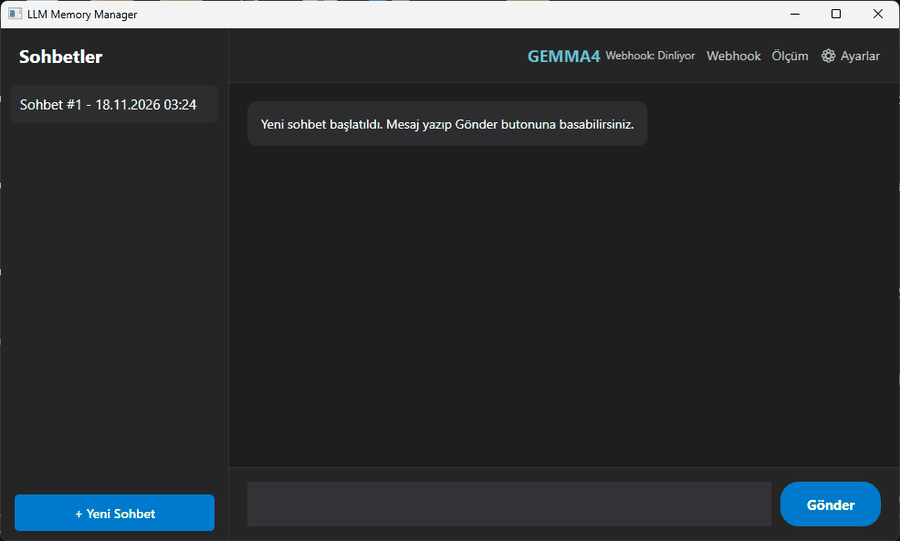
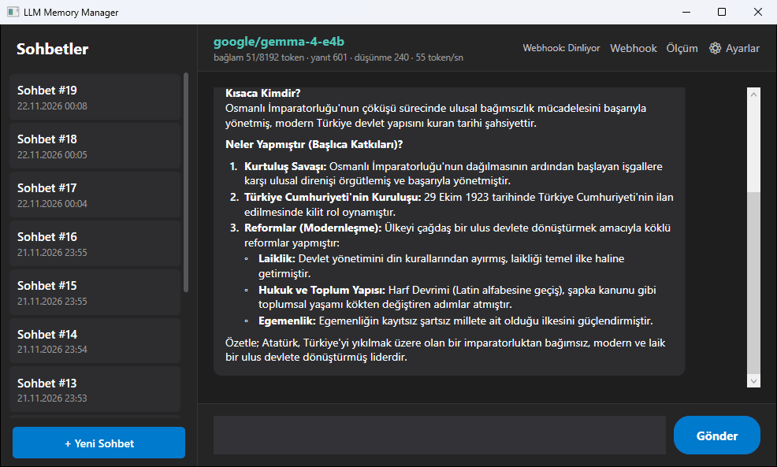
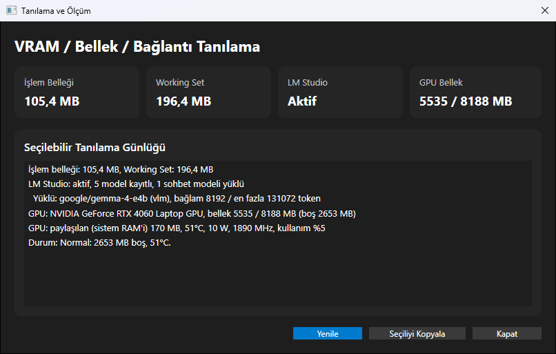
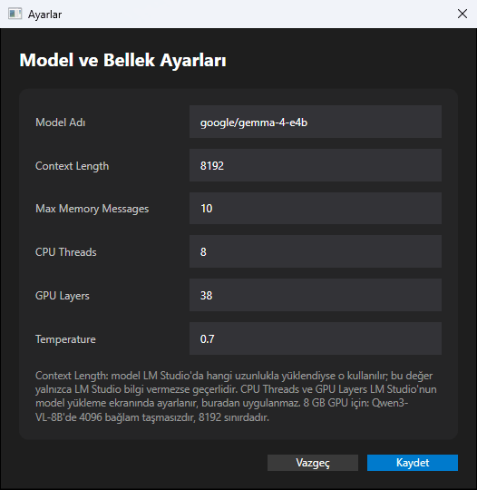

# 🧠 LLM Memory Manager


Bilgisayarda yerel olarak çalışan bir dil modeliyle (**LM Studio** üzerinden Gemma) sohbet eden ve sohbet geçmişini **SQL Server**'da saklayan **WPF / .NET 10** masaüstü uygulaması. Uzun sohbetlerde modele gönderilecek bağlamı (context) mesaj ve token sınırıyla yöneterek düşük VRAM'li ekran kartlarında da kullanılabilmesini hedefler.

---

## 🎬 Demo



Sohbet listesi, **Ölçüm** (VRAM / bellek / bağlantı tanılama) ve **Ayarlar** pencereleri.

| Ana ekran | Tanılama ve ölçüm | Model ve bellek ayarları |
| --- | --- | --- |
|  |  |  |

> Kayıt LM Studio kapalıyken alındı; bu yüzden tanılama ekranında LM Studio "Ulaşılamıyor" görünüyor. Sohbet için LM Studio'da bir model yüklü olmalıdır.
>
> Görüntüler, depodaki kurulum script'iyle kurulan örnek veritabanı üzerinde uygulama çalıştırılarak alınmıştır.


## 🚀 Özellikler

- **Sohbet arayüzü:** Oturum (sohbet) listesi, yeni sohbet başlatma, mesaj gönderme
- **Kalıcı hafıza:** Kullanıcılar, oturumlar ve tüm mesajlar SQL Server'da tutulur (EF Core)
- **Token bütçeli bağlam:** Geçmiş, modelin LM Studio'da *gerçekten* yüklü olduğu bağlam uzunluğuna sığacak kadar gönderilir; yanıta (ve düşünen modellerin düşünmesine) yer ayrılır. Sığmayan eski mesajlar bilerek çıkarılır, kısa bir notu talimata eklenir. LM Studio bağlam dolunca hata vermeden geçmişin ortasını sessizce sildiği için kırpma uygulamada yapılır.
- **Kendini düzelten token tahmini:** Temel tahmin 3 karakter/token; her yanıttaki gerçek `prompt_tokens` ile model başına çarpan öğrenilir (Türkçe/JSON/kod farkları). Kelime saymak gerçeğin yarısını veriyordu.
- **Akışlı yanıt:** Cevap yazıldıkça görünür, düşünen modellerde "Düşünüyor… (N token)" gösterilir; zaman aşımı toplam süre değil 120 sn sessizliktir. Üst çubukta bağlam/yanıt/düşünme token'ları ve hız yazar.
- **Düşünen model koruması:** Gemma 4 kısa bir cevaptan önce ~500 token düşünür; eski `max_tokens=512` ile cevap boş geliyordu. Bütçe artık bağlamdan hesaplanır, yine yetmezse kalan bağlamla bir kez yeniden denenir.
- **Tek sıra:** Sohbet ve WhatsApp istekleri aynı anda GPU'ya gönderilmez; sırayla işlenir.
- **Model ayarları penceresi:** Model adı, hafızadaki mesaj sayısı ve temperature uygulanır. Context Length yalnızca LM Studio bilgi vermezse kullanılır; CPU thread / GPU layer LM Studio'nun yükleme ekranında ayarlanır.
- **Tanılama ve ölçüm penceresi:** Uygulama belleği, LM Studio'da yüklü modeller ve bağlam uzunlukları, GPU belleği, **paylaşılan belleğe taşma**, sıcaklık, güç ve saat hızı; birden çok model yüklüyse uyarı
- **WhatsApp webhook (deneysel):** Yerel bir HTTP dinleyicisi (`localhost:5000`) gelen mesajı kaydeder, sohbet geçmişiyle modelden yanıt alır ve harici bir Node.js WhatsApp köprüsüne (`localhost:3000`) iletir

## 💾 8 GB GPU için öneriler (RTX 4060 Laptop üzerinde ölçüldü)

| Model / bağlam | GPU belleği | Sonuç |
| --- | --- | --- |
| Qwen3-VL-8B Q4_K_M, 4096 | 7,08 / 8 GB | Taşma yok, ~42 token/sn |
| Qwen3-VL-8B Q4_K_M, 8192 | 7,66 / 8 GB | Sınırda; tarayıcı/kamera GPU kullanırsa taşar (22 token/sn'ye düştüğü görüldü) |
| Qwen3-VL-8B Q4_K_M, 12288 | 7,74 GB + ~500 MB RAM | Taşma |
| İki 7B model aynı anda | > 8 GB | ~6 token/sn |

- LM Studio'da **tek model** yüklü tutun; uzun sohbette sıcaklık 61–68°C, güç ~65–75 W ölçüldü (kısılma yok).
- Uzun sohbetler bağlamı büyütür, hız 41 → 33 token/sn'ye iner; uygulama geçmişi bütçeye göre kırptığı için taşma olmaz.

## 🏗️ Mimari

```
LLM Memory Manager/
├── MainWindow.xaml(.cs)        ← Sohbet ekranı
├── SettingsWindow.xaml(.cs)    ← Model ve bellek ayarları
├── DiagnosticsWindow.xaml(.cs) ← Bellek / GPU / bağlantı ölçümleri
├── Database/
│   ├── AppDbContext.cs         ← EF Core DbContext (tablo eşlemeleri)
│   └── ChatRepository.cs       ← Kullanıcı, oturum ve mesaj işlemleri (async)
├── Models/                     ← User, Session, ChatMessage, AppSettings
└── Services/
    ├── ConversationService.cs  ← Sohbet ve webhook'un ortak akışı (geçmiş → bütçe → model → kayıt)
    └── WhatsappWebhookService.cs

LlmBridge.Core/                 ← Arayüzden bağımsız LLM çekirdeği (ileride ara köprü de kullanır)
├── LmStudioClient.cs           ← Akışlı istemci, düşünme ayrımı, sessizlik zaman aşımı, tek sıra
├── ContextBuilder.cs           ← Token bütçesine göre geçmiş kırpma
├── TokenEstimator.cs           ← Token tahmini + gerçek sayıdan öğrenen çarpan
├── ChatPipeline.cs             ← Model/bağlam okuma, bütçe, yeniden deneme, uyarılar
└── GpuMonitor.cs               ← VRAM, paylaşılan bellek (taşma), sıcaklık

LlmBridge.Core.Tests/           ← xUnit testleri (sahte sunucuyla; LM Studio gerekmez)
```

## 🗄️ Veritabanı (`LLM`)

`Veri Tabanı/LLM.sql` ile oluşturulan 4 tablo: `T_User`, `T_Session`, `T_Chat` (mesaj + token sayısı), `T_Settings` (model parametreleri). EF Core, `OnModelCreating` içinde bu tablolara eşlenir.

---

## ⚙️ Kurulum

**Gereksinimler:**
- Visual Studio 2026 (veya .NET 10 SDK destekleyen Visual Studio 2022) – *.NET masaüstü geliştirme* iş yükü
- SQL Server (Express yeterli) ve SQL Server Management Studio (SSMS) 22
- [LM Studio](https://lmstudio.ai/) – bir model yükleyip **Local Server**'ı `1234` portunda başlatın

1. **İndirin**
   ```bash
   git clone https://github.com/GencayCeliker/LLM-Memory-Manager.git
   ```
2. **Veritabanını kurun (SSMS 22):** `Veri Tabanı/LLM.sql` dosyasını açıp **Execute (F5)**'e basın.
3. **Bağlantıyı kontrol edin:** `LLM Memory Manager/Database/AppDbContext.cs` içinde `Server=.\SQLEXPRESS;Database=LLM` kullanılır; farklı bir sunucu kullanıyorsanız burayı değiştirin.
4. **Çalıştırın:** `LLM Memory Manager.slnx` dosyasını açın ve **F5** ile başlatın. LM Studio'da modelin yüklü ve sunucunun açık olduğundan emin olun.

> WhatsApp entegrasyonu için ayrıca bir Node.js WhatsApp köprüsü gerekir; bu depoda yer almaz. Uygulamanın geri kalanı onsuz çalışır.

## 📄 Lisans

Bu proje [MIT](LICENSE) lisansı altında sunulmuştur.
